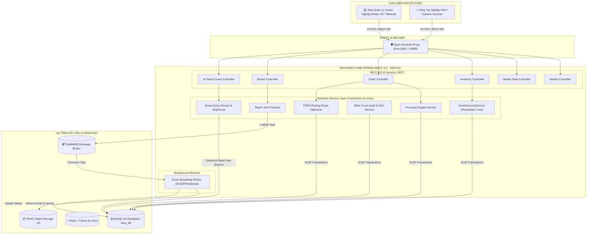

# 🏭 SMART WMS — ENTERPRISE WAREHOUSE MANAGEMENT SYSTEM

<p align="center">
  
</p>

<p align="center">
  <b>Hệ Thống Quản Trị Kho Hàng Doanh Nghiệp Thông Minh Tích Hợp AI & Hàng Đợi Bất Đồng Bộ</b><br>
  <i>Quản lý kho đa chi nhánh theo Lô và Ô kệ (Bin Location), cấp phát xuất kho FEFO, sổ cái thẻ kho bất biến (Immutable Ledger), phân tách nhiệm vụ độc lập (SoD) và trợ lý AI truy vấn an toàn.</i>
</p>

<p align="center">
  
  
  
  
  
  
  
  
  
  
  
</p>

---

## 📖 1. Giới thiệu tổng quan

**SMART WMS** là giải pháp phần mềm quản trị kho hàng doanh nghiệp chuẩn Enterprise, được thiết kế để giải quyết triệt để các bài toán sống còn trong quản lý kho hiện đại: thất thoát hàng hóa, tồn kho ảo, xung đột xuất hàng giờ cao điểm (Race Condition), hết hạn sử dụng không kịp luân chuyển và rủi ro gian lận kiểm toán.

Thay vì quản lý tồn kho theo kiểu số lượng gộp truyền thống, **Smart WMS** xây dựng mô hình số hóa kho vận khép kín từ **A đến Z**:

1. **Quản lý vị trí 6 cấp (Bin Location Topology)**: Chia nhỏ mặt bằng kho chi tiết đến từng vị trí: `Kho (Warehouse) -> Khu vực (Zone) -> Dãy (Aisle) -> Kệ (Rack) -> Tầng (Shelf) -> Ô (Bin)`.
2. **Chiến lược cấp phát xuất kho FEFO (First-Expired, First-Out)**: Tự động phát hiện và cấp phát các Lô hàng có hạn dùng gần nhất ra trước, triệt tiêu tối đa rủi ro hư hỏng hàng quá hạn.
3. **Sổ cái thẻ kho bất biến (Immutable Stock Ledger)**: Áp dụng nguyên tắc kế toán tài chính **Append-Only**, CSDL MySQL kích hoạt Trigger chặn 100% lệnh UPDATE/DELETE lịch sử biến động kho.
4. **Kiểm soát nội bộ & Phân tách nhiệm vụ (Segregation of Duties - SoD)**: Rào chắn bảo mật nghiêm ngặt ngăn không cho người tạo đợt kiểm kê tự duyệt chênh lệch sổ sách.
5. **Cổng tác nghiệp di động PDA / Quét Barcode**: Nhân viên cầm tay quét mã vạch kiểm nhận tại khu đệm (Staging QC), cất hàng (Putaway), gom hàng (Picking), điều chuyển và đếm mù (Blind Count).
6. **Trợ lý Trí tuệ Nhân tạo Lai (Hybrid AI) & Lá chắn AST**: Kết hợp Google Gemini AI và Semantic Engine hỗ trợ sinh mã SKU chuẩn, tự phân loại danh mục và truy vấn ngôn ngữ tự nhiên an toàn tuyệt đối với JSqlParser.

---

## ✨ 2. Tính năng nổi bật & Nghiệp vụ thực chiến

### 🏢 Quản lý Mặt bằng Số hóa 2D (Digital Twin Warehouse)
- **Mặt bằng kho 2D tương tác trực quan**: Xem tỷ lệ lấp đầy (Occupancy Rate), cảnh báo ô kệ quá tải, kiểm tra hạn dùng theo mã màu trực tiếp trên lưới tọa độ.
- **Khung nhìn hình chiếu đứng (Rack Elevation Grid)**: Bóc tách từng Rack/Shelf/Bin, xem mặt cắt dọc từng tầng kệ để điều phối xe nâng pallet.
- **In tem nhãn Barcode chuẩn GS1**: Tự động sinh và in nhãn mã vạch Code128 / QR Code cho vị trí ô kệ, thùng hàng và lô sản phẩm.

### 📥 Nhập kho & Kiểm định QC 2 bước (Inbound & Putaway)
- **Cổng tiếp nhận Staging Buffer**: Nhân viên đếm hàng thực nhận (`receivedQty`) và bóc tách hàng lỗi/hỏng (`rejectedQty`). Chỉ hàng đạt QC mới được cấp mã Lô và HSD.
- **Động cơ cất kệ thông minh (Putaway Engine)**: Tự động tính toán dung tích khả dụng, phân loại Zone bảo quản (Khô/Mát/Lạnh/An ninh) và tự động ưu tiên tầng trệt (`Shelf S01`) cho hàng nặng (> 100kg).
- **Cất kệ đa vị trí (Multi-bin Putaway)**: Cho phép chia nhỏ một lô hàng lớn để cất vào nhiều ô kệ khác nhau linh hoạt.

### 📤 Xuất kho FEFO & Giải phóng Giữ chỗ tức thì (Outbound & Order Release)
- **Cấp phát tự động FEFO**: Tự động khóa giữ chỗ (`reservedQty`) trên các ô kệ có lô cận date nhất bằng Khóa bi quan (`SELECT FOR UPDATE`), bảo đảm `Available Qty = OnHand - Reserved >= 0`.
- **Cơ chế Hủy đơn & Giải phóng kho tức thời (Order Release Guard)**: Khi đơn SO bị hủy ở trạng thái `ALLOCATED` hoặc `PICKING`, hệ thống tự động hoàn trả 100% số lượng giữ chỗ về tồn khả dụng ngay lập tức, không làm gián đoạn nguồn cung.
- **Gom hàng Picking & Xuất xưởng Dispatch**: Hỗ trợ lộ trình nhặt hàng tối ưu 1 chiều, đóng gói và chốt trừ tồn vật lý khi xe lăn bánh.

### 🔍 Kiểm kê Thực địa & Cân đối Sổ cái (Cycle Count Audit & Reconciliation)
- **Kiểm kê mù (Blind Count)**: Nhân viên PDA quét mã ô kệ đếm thực tế mà không nhìn thấy số tồn lý thuyết trên hệ thống để tránh đoán số.
- **Vòng đếm lại (Recount / Double-check)**: Tự động kích hoạt khi có sai lệch lớn, yêu cầu thủ kho thứ hai thẩm tra.
- **Cân đối chuẩn xác chống âm kho**: Tồn sau cân đối được gán trực tiếp bằng số lượng thực đếm (`after = countedQty`), triệt tiêu hoàn toàn lỗi âm kho do lệch snapshot. Tự động sinh chứng từ `ADJ-AUD-...` và ghi thẻ kho bất biến.

### ⚡ Thông báo Thời gian thực & Điều hướng Sâu (Real-time SSE & Deep Linking)
- **Server-Sent Events (SSE) Stream**: Kênh HTTP 1 chiều đẩy thông báo ngay lập tức khi có biến động kho, tự động kết nối lại khi rớt mạng.
- **Deep Linking**: Click vào thông báo lập tức chuyển hướng đến đúng đơn hàng `/outbound?soCode=...` hoặc đợt kiểm kê `/audit?auditCode=...` và tự động mở modal chi tiết.

---

## 📂 3. Cấu trúc thư mục dự án

```text
smart-wms/
├── docker/
│   ├── nginx/
│   │   └── nginx.conf                         # Reverse Proxy, SSL, Rate Limit, định tuyến API/Static
│   ├── mysql/
│   │   └── init/
│   │       ├── 01-init-schema.sql             # Khởi tạo CSDL, bảng nghiệp vụ wms_db
│   │       ├── 02-create-views.sql            # Tạo các View nghiệp vụ báo cáo
│   │       └── 08-inbound-qc-ledger.sql       # Trigger bảo vệ thẻ kho bất biến
│   └── rabbitmq/
│       ├── definitions.json                  # Cấu hình Exchanges, Queues, DLX, Routing Keys
│       └── rabbitmq.conf                      # Cấu hình Web Management UI trên cổng 15672
├── docker-compose.yml                        # Điều phối 6 container: MySQL, Redis, RabbitMQ, MinIO, Backend, Frontend
├── Makefile                                  # Lệnh tắt: make up, make down, make test
├── README.md                                 # Cẩm nang tổng quan dự án (Showcase GitHub)
├── SMART_WMS_ARCHITECTURE.md                 # Tài liệu đặc tả kiến trúc kỹ thuật chuyên sâu
├── LUONG_DU_LIEU_VA_QUY_TAC_NGHIEP_VU.md      # Quy tắc nghiệp vụ và các bất biến kỹ thuật
├── favicon.svg                               # Logo biểu trưng của hệ thống
│
├── backend/                                  # ================= JAVA SPRING BOOT 3.5 =================
│   ├── Dockerfile
│   ├── pom.xml                               # Java 25, Spring Boot 3.5, MySQL Connector, JSqlParser, POI
│   └── src/main/java/com/wms/
│       ├── common/                           # Exception Handler, Base ApiResponse, Security Utils
│       └── module/
│           ├── identity/                     # Phân hệ Xác thực JWT, User, RBAC, SoD, Session Lock
│           ├── masterdata/                   # Phân hệ Kho, Ô kệ (Bin), Sản phẩm, Lô hàng, Ca trực
│           ├── order/                        # Phân hệ Đơn Nhập (PO), Đơn Xuất (SO), Cấp phát FEFO, Picking
│           ├── inventory/                    # Phân hệ Tồn kho, Khóa bi quan, Thẻ kho, Kiểm kê Audit, Điều chuyển
│           ├── notification/                 # Phân hệ Real-time SSE Stream & WebSocket Broadcasting
│           ├── reporting/                    # Phân hệ Báo cáo nền với RabbitMQ Worker & MinIO S3
│           └── smartquery/                   # Trợ lý AI Gemini 1.5, Lá chắn AST Sanitizer JSqlParser
│
└── frontend/                                 # ================= REACT 18 + TYPESCRIPT =================
    ├── Dockerfile
    ├── nginx.conf                            # Nginx phân phối bundle SPA & proxy /api/
    ├── package.json                          # React 18, Vite, Tailwind CSS, TanStack Query, Zustand, Lucide
    └── src/
        ├── app/                              # Layout, Sidebar, Header, Routes bảo vệ theo Role
        ├── components/                       # Scanner Barcode Camera, UI Dialogs, Badges
        └── features/
            ├── auth/                         # Form Đăng nhập, Quên mật khẩu, Rào chắn giá vốn
            ├── dashboard/                    # KPI Kho, Biểu đồ lấp đầy, Sandbox mô phỏng Khóa bi quan
            ├── masterdata/                   # Sơ đồ kho 2D Floor Plan, Quản lý Chi nhánh, Ca trực
            ├── inbound/                      # Quản lý PO, Modal QC Staging, Modal Cất kệ Multi-bin
            ├── outbound/                     # Quản lý SO, Bàn làm việc FEFO, Modal Hủy đơn giải phóng kho
            ├── inventory/                    # Tra cứu Thẻ kho bất biến, Tồn khả dụng, Điều chuyển ô kệ
            ├── audit/                        # Quản lý Đợt kiểm kê, Modal Đếm thực tế, Modal Cân đối SoD
            ├── operator/                     # Cổng di động PDA: Staging, Putaway, Picking, Transfer, Blind Count
            ├── labels/                       # Trung tâm thiết kế & in tem Barcode ô kệ, Lô sản phẩm
            ├── users/                        # Quản trị Nhân sự, Phân quyền RBAC Matrix, Thiết bị PDA
            ├── reporting/                    # Trung tâm trích xuất báo cáo Excel bất đồng bộ
            └── smartquery/                   # Giao diện Chatbot AI truy vấn kho bằng tiếng Việt
```

---

## 🏗️ 4. Kiến trúc hệ thống (Modular Monolith & Event-Driven)



---

## 👥 5. Ma trận phân quyền RBAC & Kiểm soát nội bộ SoD

### 5.1. Ma trận 3 cấp vai trò
- **`ROLE_ADMIN` (Nguyễn Quản Trị / `admin`)**: Cấu hình chi nhánh kho, phân quyền người dùng, quản trị thiết bị PDA, quản lý danh mục sản phẩm/vị trí ô kệ, tạo đợt kiểm kê tổng thể.
- **`ROLE_WAREHOUSE_MANAGER` (Trần Trưởng Kho / `manager01`)**: Điều hành hoạt động xuất/nhập, duyệt lệnh cấp phát FEFO, hủy đơn giải phóng hàng giữ trước, đối soát và phê duyệt cân đối kiểm kê (ghi thẻ kho bất biến), xem báo cáo giá vốn.
- **`ROLE_OPERATOR` (Lê Thủ Kho / `operator01`)**: Nhân viên hiện trường vận hành máy quét PDA. Bị ẩn hoàn toàn giá tiền (`canViewCostPrice = false` $\rightarrow$ hiển thị `***`). Thao tác 5 nghiệp vụ thực địa: Tiếp nhận Staging QC, Cất hàng Putaway, Nhặt hàng Picking FEFO, Điều chuyển ô kệ, Đếm mù Blind Count.

### 5.2. Rào chắn Phân tách Nhiệm vụ Kiểm kê (SoD Security Guard)
```
[Người Lập Kiểm Kê (Created By)] ──X── BỊ CHẶN TUYỆT ĐỐI ──X──► [Duyệt Cân Đối Kho & Ghi Sổ Cái]
                                                                        ▲
                                                              BẮT BUỘC  │
                                                                        ▼
                                                   [Quản Lý Kho Độc Lập (Independent Manager)]
```
- **Quy tắc**: Người tạo đợt kiểm kê hoặc người trực tiếp kiểm đếm tại kệ không được phép tự duyệt cân đối kho. Giao diện hiển thị cảnh báo đỏ và khóa nút nếu phát hiện người duyệt trùng với người lập đợt.

---

## 📊 6. Bộ 6 Quy tắc bất biến kỹ thuật cốt tử (Critical Invariants)

> [!IMPORTANT]
> 6 nguyên tắc bất biến bảo đảm hệ thống vận hành ổn định và không bao giờ xảy ra lỗi sai lệch số liệu:

1. **Bất biến Tồn Khả Dụng (Availability Invariant)**:
   $$\text{Tồn khả dụng (Available)} = \text{Tồn thực tế (On-Hand)} - \text{Đang giữ chỗ (Reserved)} \ge 0$$
   Tồn khả dụng không bao giờ được phép âm.
2. **Bất biến Thẻ Kho (Immutability Invariant)**: Bảng `wms_stock_ledger` chỉ nhận lệnh `INSERT`. CSDL kích hoạt trigger chặn đứng 100% mọi câu lệnh `UPDATE` hoặc `DELETE`.
3. **Bất biến Khóa Đồng Thời (Pessimistic Locking)**: Mọi thao tác tranh chấp tồn kho (giữ chỗ FEFO, cất hàng, xuất kho) đều phải sử dụng khóa dòng bi quan:
   ```sql
   SELECT * FROM wms_inventory WHERE id = :id FOR UPDATE
   ```
4. **Bất biến Cổng Kiểm Định Chất Lượng (QC Quality Gate)**: Chỉ hàng đạt chuẩn chất lượng (`receivedQty - rejectedQty > 0`) mới được cấp phát mã lô và cất lên kệ. Hàng hỏng buộc phải nằm lại khu đệm Staging.
5. **Bất biến Phân Tách Trách Nhiệm (SoD Gate)**: Người tạo đợt kiểm kê không được phép duyệt cân đối đợt kiểm kê do chính mình tạo ra.
6. **Bất biến Phạm Vi Chi Nhánh Kho**: Mọi ô kệ cất hàng, nhặt hàng hoặc điều chuyển bắt buộc phải thuộc cùng một chi nhánh kho (`warehouse_id`) của chứng từ đó.

---

## 🛠️ 7. Hướng dẫn cài đặt & Khởi chạy 1-Click

### Yêu cầu tiên quyết
- **Docker & Docker Compose v2**: Đã cài đặt Docker Desktop trên Windows/macOS/Linux.

### Khởi chạy toàn bộ hệ thống
Tại thư mục gốc của dự án, mở Terminal và chạy:

```bash
# 1. Khởi chạy toàn bộ 6 container (Build Java 25 & React 18)
docker compose up -d --build

# 2. Kiểm tra trạng thái hoạt động của các dịch vụ
docker compose ps
```

### Danh mục Cổng dịch vụ (Service Endpoints)

| Dịch vụ | Địa chỉ truy cập | Tài khoản mặc định | Mật khẩu mặc định |
| :--- | :--- | :---: | :---: |
| **Web Doanh Nghiệp (Frontend)** | **http://localhost:3000** | `admin` / `manager01` / `operator01` | `123456` |
| **REST API Backend** | `http://localhost:8080/api/v1` | — | — |
| **Cơ sở dữ liệu MySQL 8.0** | `localhost:3307` (DB: `wms_db`) | `wms_user` | `wms_password` |
| **Quản trị Hàng đợi RabbitMQ**| `http://localhost:15672` | `guest` | `guest` |
| **Quản trị Lưu trữ MinIO S3** | `http://localhost:9001` | `minioadmin` | `minioadmin` |

---

## 📱 8. Cổng vận hành thực địa Mobile PDA

Giao diện chuyên dụng tối ưu cho thiết bị cầm tay PDA hoặc điện thoại thông minh tại `/operator`:

<p align="center">
  
  
  
</p>

1. **Tab STAGING (Tiếp nhận hàng)**: Quét mã PO, nhập số lượng thực nhận, nhập số lượng lỗi, khai báo Lô & HSD.
2. **Tab PUTAWAY (Cất kệ)**: Nhận gợi ý ô kệ thông minh từ hệ thống, quét Barcode ô đích, cất hàng vào kệ.
3. **Tab PICKING (Gom hàng FEFO)**: Hiển thị danh sách lấy hàng sắp xếp theo lộ trình tối ưu, quét mã xác nhận lấy hàng.
4. **Tab TRANSFER (Điều chuyển ô)**: Quét mã ô nguồn, quét mã ô đích, chuyển hàng nội bộ trong kho tức thì.
5. **Tab BLIND COUNT (Đếm mù)**: Quét mã ô kệ, đếm số lượng thực tế tại chỗ không hiển thị tồn lý thuyết.

---

## 🤖 9. Trợ lý AI Lai & Lá chắn an toàn Text-to-SQL

<p align="center">
  
  
  
</p>

- **Hỏi đáp kho bằng Tiếng Việt**: *"Cho tôi xem top 5 mặt hàng có hạn dùng gần nhất tại Kho Tổng Tân Bình"*.
- **Phòng thủ 3 lớp an toàn tuyệt đối**:
  1. **Lớp 1 (Read-Only User)**: Kết nối CSDL sử dụng tài khoản chỉ có quyền `SELECT` trên các View tổng hợp.
  2. **Lớp 2 (AST Parser với JSqlParser)**: Phân tích cú pháp cây trừu tượng của câu SQL. Chặn 100% nếu phát hiện câu lệnh thay đổi dữ liệu (`DROP`, `DELETE`, `UPDATE`, `INSERT`, `ALTER`), chỉ chấp nhận câu lệnh `SELECT`.
  3. **Lớp 3 (Resource Guard)**: Tự động ép mệnh đề `LIMIT 50` vào cuối câu để ngăn chặn tràn bộ nhớ RAM.

---

## 🎓 10. Kịch bản bảo vệ đồ án tốt nghiệp & Phản biện hội đồng (Q&A Cheatsheet)

### Câu 1: Tại sao nhóm chọn Modular Monolith thay vì Microservices?
- **Trả lời**: *"Trong quản trị kho, tính toàn vẹn dữ liệu tức thời (Immediate Strict Consistency - ACID) là tiêu chí sống còn. Nếu chia nhỏ thành Microservices, việc giữ chỗ tồn kho và xuất hàng sẽ phụ thuộc vào Distributed Transactions (Saga / 2PC) qua mạng, dẫn đến độ trễ và rủi ro bán âm kho rất lớn. Kiến trúc Modular Monolith giúp hệ thống tận dụng tối đa Database Transactions và Khóa bi quan (`SELECT FOR UPDATE`), giải quyết triệt để Race Condition trong khi mã nguồn vẫn được tách biệt nghiêm ngặt theo các Module nghiệp vụ độc lập theo chuẩn DDD."*

### Câu 2: Khi nhiều người cùng đặt xuất 1 lô hàng cận date cùng 1 giây, hệ thống xử lý thế nào?
- **Trả lời**: *"Hệ thống sử dụng kỹ thuật **Pessimistic Locking (Khóa bi quan)** tại tầng cơ sở dữ liệu. Khi giao dịch đầu tiên vào cấp phát, câu lệnh `SELECT ... FOR UPDATE` sẽ khóa dòng tồn kho của ô kệ đó lại. Giao dịch thứ hai buộc phải xếp hàng chờ cho đến khi giao dịch thứ nhất hoàn tất việc tăng `reserved_qty` và commit transaction. Khi giao dịch thứ hai vào đọc, số lượng tồn khả dụng (`OnHand - Reserved`) đã giảm về 0, hệ thống phát hiện ngay và ném ngoại lệ `INSUFFICIENT_STOCK` an toàn."*

### Câu 3: Thẻ kho (Stock Ledger) có vai trò gì và tại sao cấm tuyệt đối sửa xóa?
- **Trả lời**: *"Trong kế toán kho và kiểm toán tài chính doanh nghiệp, thẻ kho là chứng từ pháp lý chứng minh mọi biến động hàng hóa. Bảng `wms_stock_ledger` được thiết kế theo nguyên lý **Append-Only**. Mọi hành vi nhập, xuất, cân đối kiểm kê hay điều chuyển đều chỉ được ghi nhận dưới dạng một dòng mới có chênh lệch (+/-) và số dư tồn sau giao dịch (`balance_after`). Phía CSDL có Trigger khóa cứng không cho chạy lệnh UPDATE hay DELETE, bảo đảm tính minh bạch kiểm toán 100%."*

### Câu 4: Nguyên tắc Phân tách nhiệm vụ (Segregation of Duties - SoD) trong kiểm kê hoạt động thế nào?
- **Trả lời**: *"Nguyên tắc SoD được áp dụng nhằm ngăn ngừa gian lận nội bộ. Nếu một người vừa là thủ kho trực tiếp kiểm đếm, vừa có quyền tự duyệt chênh lệch, họ có thể lấy cắp hàng hóa rồi tự lập phiếu kiểm kê để hợp thức hóa số tồn bị thiếu. Trong Smart WMS, nếu tài khoản `admin` là người tạo phiên kiểm kê, hệ thống sẽ chặn không cho tài khoản này duyệt cân đối sổ cái. Việc phê duyệt bắt buộc phải do một người quản lý độc lập khác (như `manager01` - Trưởng kho) thực hiện sau khi thẩm tra biên bản đối soát."*

### Câu 5: Lỗi âm kho (-42) khi cân đối kiểm kê là gì và hệ thống đã chuẩn hóa theo nghiệp vụ ra sao?
- **Trả lời**: *"Lỗi này phát sinh do công thức cũ cộng dồn chênh lệch snapshot: `Tồn hiện tại + (countedQty - systemQty)`. Nếu thời điểm tạo snapshot hệ thống có 60 cái, sau đó một giao dịch khác đã xuất bớt 43 cái (tồn còn 17), khi kiểm kê thực tế còn 1 cái (chênh lệch -59), công thức cũ lấy `17 + (-59) = -42` dẫn đến tồn kho bị tính âm sai lệch. Nghiệp vụ kho thực tế quy định: **Số lượng tồn kho sau cân đối chính là số lượng thực tế nhân viên đếm được tại kệ**. Chúng em đã chuẩn hóa lại logic backend: gán trực tiếp tồn mới bằng số thực đếm (`after = countedQty = 1`), và thẻ kho chỉ ghi nhận chênh lệch giữa số thực đếm và số tồn thực tế trên kệ tại thời điểm duyệt. Nhờ đó, số liệu sau cân đối luôn khớp 100% với thực tế tại kho."*

---

<p align="center">
  <b>Smart WMS — Enterprise Warehouse Management System</b><br>
  Được phát triển phục vụ Đồ án Tốt nghiệp & Ứng dụng Doanh nghiệp Thực chiến.
</p>
