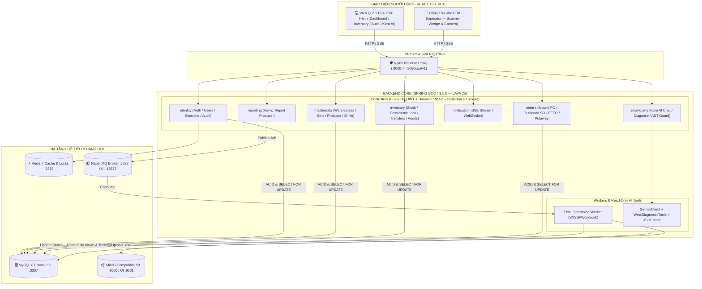

# 🏭 SMART WMS — ENTERPRISE WAREHOUSE MANAGEMENT SYSTEM

<p align="center">
  
</p>

<p align="center">
  <b>Hệ Thống Quản Trị Kho Hàng Doanh Nghiệp Thông Minh Tích Hợp Trợ Lý Kora AI & Hàng Đợi Bất Đồng Bộ</b><br>
  <i>Quản lý kho đa chi nhánh 6 cấp theo Lô (Batch) & Ô kệ (Bin Location), cấp phát xuất kho FEFO, sổ cái thẻ kho bất biến (Immutable Ledger), phân tách nhiệm vụ độc lập (SoD), kiểm soát phiên tối đa 2 thiết bị FIFO và trợ lý Kora AI đa lớp bảo mật.</i>
</p>

<p align="center">
  
  
  
  
  
  
  
  
  
  
  
  
</p>

---

## 📖 1. Giới thiệu tổng quan

**SMART WMS** là giải pháp phần mềm quản trị kho hàng doanh nghiệp chuẩn Enterprise, được thiết kế để giải quyết triệt để các bài toán sống còn trong vận hành kho hiện đại: thất thoát hàng hóa, tồn kho ảo, xung đột xuất hàng giờ cao điểm (Race Condition), hàng cận hạn không kịp luân chuyển, lỗi thao tác thủ kho hiện trường và rủi ro gian lận kiểm toán.

Hệ thống xây dựng quy trình số hóa kho vận khép kín từ **A đến Z**:

1. **Cấu trúc vị trí 6 cấp (Bin Location Topology)**: Chia nhỏ mặt bằng kho chi tiết đến từng ô chứa: `Kho (Warehouse) → Khu vực (Zone: A/B/C/QUA) → Dãy (Aisle) → Kệ (Rack) → Tầng (Shelf) → Ô (Bin)`.
2. **Chiến lược cấp phát & lộ trình nhặt hàng FEFO (First-Expired, First-Out)**: Tự động giữ chỗ các lô có hạn sử dụng gần nhất bằng Khóa bi quan (`SELECT FOR UPDATE`), kết hợp sắp xếp lộ trình nhặt hàng ưu tiên HSD theo từng ô kệ.
3. **Sổ cái thẻ kho bất biến (Immutable Stock Ledger)**: Áp dụng nguyên tắc kế toán **Append-Only**; Trigger MySQL chặn 100% lệnh `UPDATE` / `DELETE` trên lịch sử biến động tồn kho.
4. **Kiểm soát nội bộ & Phân tách nhiệm vụ (Segregation of Duties — SoD)**: Rào chắn bảo mật ngăn người lập phiếu kiểm kê tự phê duyệt cân đối sổ sách; ép quy trình kiểm kê mù (`Blind Count`) trên thiết bị cầm tay.
5. **Cổng Thủ Kho Hiện Trường PDA (`/operator`)**: Tối ưu cho súng quét mã vạch (Hardware Scanner Wedge) và Camera thiết bị di động qua 5 phân hệ khép kín: Tiếp nhận QC (`Staging`), Cất kệ (`Putaway`), Lấy hàng `FEFO`, Điều chuyển nội bộ và Đếm mù (`Blind Count`).
6. **Trợ lý Kho Vận Thông Minh Kora AI (`smartquery`)**: Kết hợp **Google Gemini Function Calling** (4 công cụ Read-Only chẩn đoán sự cố thực tế) với **Text-to-SQL được kiểm duyệt bằng cây cú pháp AST (`JSqlParser 4.9`)** và **cô lập đa kho theo JWT (`WmsWarehouseAccessGuard`)**.

---

## ✨ 2. Tính năng nổi bật & Nghiệp vụ thực chiến

### 📊 Dashboard Hai Góc Nhìn (Super Admin System & Operations Audit)
- **Góc nhìn Quản Trị Hệ Thống (chuẩn ISO 27001 / SoD)**: Theo dõi tổng nhân sự & ma trận RBAC, mạng lưới 7 chi nhánh kho toàn quốc, IP tin cậy từng kho và Nhật ký Kiểm toán An ninh (`Security Audit Logs`).
- **Góc nhìn Giám Sát Vận Hành (Audit)**: Chuyển đổi phạm vi toàn mạng lưới (`ALL`) hoặc từng chi nhánh (`WH01`–`WH07`), lọc theo kỳ thời gian (`Tháng này`, `Hôm nay`, `7 ngày qua`, `Tùy chọn`, `Toàn thời gian`), hàng đợi `Công việc cần xử lý` (SO Picking / PO Putaway / Audit `PENDING_REVIEW`), `Cảnh báo kho` (`Cận hạn & hết hạn`, `Dưới an toàn`, `Hết tồn`), biểu đồ `Xu hướng nhập – xuất 6 tháng`, `Tỷ lệ ô lưu trữ theo Zone` (gồm cả `ZONE_QUA` Khu cách ly) và bảng xếp hạng `Top mặt hàng xuất`.

### 🏢 Mặt bằng Số hóa 2D & In Tem Nhãn GS1 (`masterdata` & `labels`)
- **Mặt bằng kho 2D & Mặt cắt kệ dọc**: Theo dõi tỷ lệ lấp đầy, cảnh báo quá tải trọng, lô cận hạn và thao tác khóa/mở bảo trì ô kệ trực tiếp.
- **In Tem Nhãn Mã Vạch & QR**: Sinh mã vạch Code128 (`JsBarcode`) và QR Code (`qrcode`) chuẩn tem nhiệt **`100×60mm`**, **`Decal A4`** và phiếu kiện **`Pallet A6`** cho Ô kệ, Lô hàng FEFO và Sản phẩm, hỗ trợ chọn hàng loạt và chỉnh số bản sao.

### 📥 Nhập kho, Kiểm định QC & Cất kệ Thông minh (`inbound` & `Putaway`)
- **Cổng tiếp nhận Staging & QC Gate**: Kiểm đếm thực nhận (`receivedQty`), bóc tách hàng lỗi/hỏng (`rejectedQty`), kiểm tra dung sai hợp đồng (+10%) và bắt buộc khai báo Mã lô (Batch/Lot) & HSD trước khi đưa vào khu đệm.
- **Putaway Engine**: Gợi ý ô kệ trống cùng chi nhánh theo điều kiện bảo quản (`AMBIENT` → `ZONE_A`, `COOL` → `ZONE_B`, `COLD` → `ZONE_C`, `SECURE` → `ZONE_D`) và ưu tiên tầng trệt cho hàng nặng; hỗ trợ cất kệ đa vị trí (`PARTIALLY_STOCKED`) và bắt buộc quét mã xác nhận ô đích.

### 📤 Xuất kho FEFO, Routing 2D & Giải phóng Giữ chỗ (`outbound`)
- **Cấp phát FEFO bi quan (`SELECT FOR UPDATE`)**: Tự động giữ chỗ lô gần hạn nhất, bảo đảm `Available = On-Hand - Reserved >= 0` ngay cả khi nhiều đơn xuất đồng thời.
- **Pick Path 2D & Order Release Guard**: Sắp xếp thứ tự nhặt hàng theo HSD & tọa độ kho; khi hủy đơn `ALLOCATED`/`PICKING`, hệ thống hoàn trả 100% `reservedQty` về tồn khả dụng ngay lập tức.

### 🔍 Kiểm kê Thực địa & Cân đối Sổ cái (`audit`)
- **Kiểm kê mù (Blind Count)** trên PDA ẩn hoàn toàn tồn sổ sách (`systemQty`) để thủ kho đếm trung thực; tự động mở vòng đếm lại (`Recount`) khi phát hiện chênh lệch lớn.
- **Cân đối chuẩn SoD**: Bắt buộc Quản lý kho độc lập phê duyệt; tồn sau cân đối gán trực tiếp bằng số thực đếm (`after = countedQty`), sinh chứng từ `ADJ-AUD-...` và ghi sổ cái bất biến.

### ⚡ Shell Toàn Hệ Thống, Thông báo Real-time SSE & Báo cáo Excel Bất đồng bộ
- **Omni-Search (`Ctrl+K`)**: Nhập mã ô kệ (VD: `WH01-ZB-...`) để mở thẳng Sơ đồ kho `/layout` và chọn đúng ô; nhập SKU/tên sản phẩm từ bất kỳ trang nào để nhảy sang `/inventory?search=...` và lọc tức thì.
- **Real-time SSE + Toast & Deep Linking**: Tự động kết nối `/api/notifications/stream` ngay sau khi đăng nhập SPA, phát âm báo nhẹ, đánh dấu đã đọc và mở thẳng modal SO/PO/Audit khi bấm vào thông báo.
- **Báo cáo Excel Bất đồng bộ (`reporting`)**: Đẩy job qua RabbitMQ Worker xuất file streaming `SXSSFWorkbook` (Apache POI), lưu trữ trên MinIO S3 (`pgsty/silo`) để tải xuống hoặc quản lý tập trung.

---

## 🤖 3. Kiến trúc Trợ lý Kora AI (`smartquery`) & Phòng thủ Đa tầng

Khác với chatbot Text-to-SQL thông thường, **Kora AI** sử dụng kiến trúc **Dual-Pipeline (Function Calling + AST-Guarded Text-to-SQL)** kết hợp cơ chế tự động chuyển dự phòng model (Resilient Model Fallback) qua Google Gemini REST API (`gemini-flash-lite-latest`, `gemini-3.8-flash`, `gemini-3-flash-preview`, `gemini-3.1-flash-lite`):

1. **Nhánh Chẩn đoán Sự cố (`GeminiDiagnosticService` — 4-Step Function Calling Loop)**:
   Tự động kích hoạt cho câu hỏi điều tra nguyên nhân hoặc nút **`Kora Giải Thích Kho`** (`GeminiAssistantDrawer`) nhúng ngay trong màn hình Tồn kho & Xuất kho, gọi tối đa 4 vòng các công cụ Read-Only từ `WmsDiagnosticTools`:
   - `getOutboundOrderDiagnosis`: Phân tích trạng thái cấp phát FEFO và nguyên nhân thiếu hàng từng dòng trong đơn `SO-*` / `RTV-*`.
   - `getSkuStockBreakdown`: Bóc tách 4 thành phần `On-Hand = Reserved + Blocked/Expired + Available` khớp 100% số liệu kho.
   - `getIncomingPipeline`: Kiểm tra nguồn hàng PO đang về hoặc đang nằm ở khu đệm Staging chờ Putaway.
   - `getWarehouseExceptions`: Quét nhanh điểm nghẽn toàn chi nhánh (ô kệ khóa, quá tải, lô cận/hết hạn, đơn chờ).
2. **Nhánh Truy vấn Bảng & Đàm thoại (`AiChatService` + `SqlAstSanitizer`)**:
   - **Đàm thoại ngữ cảnh**: Giữ lịch sử đa lượt theo từng tài khoản (`kora_ai_chat_sessions_v1_<username>`), bàn giao ngữ cảnh mượt mà từ Widget nổi (`FloatingGeminiWidget`) sang không gian làm việc toàn màn hình (`/assistant`), cấp thời gian thực múi giờ `Asia/Ho_Chi_Minh`.
   - **Text-to-SQL AST & Grain Rule**: Sinh SQL có kiểm soát chỉ từ hai View tổng hợp (`v_stock_summary`, `v_expiring_batches`), ép `GROUP BY sku` khi tổng hợp toàn kho tránh bị cắt dòng bởi `LIMIT 50`.
3. **3 Lớp Phòng Thủ Bảo Mật Tuyệt Đối**:
   - **Lớp 1 — JWT Warehouse RBAC (`WmsWarehouseAccessGuard`)**: Chặn hoàn toàn `ROLE_OPERATOR` truy cập AI quản trị; `ROLE_WAREHOUSE_MANAGER` chỉ được phép truy vấn các kho có trong `wms_user_warehouse_access` (mọi gợi ý mã kho trái phép trong prompt đều bị từ chối).
   - **Lớp 2 — Read-Only View & Policy Filter**: Chặn tức thì câu hỏi đòi bảng nhạy cảm (`users`, mật khẩu, lương, PII) hoặc SQL Injection (`UNION`, `SLEEP`, `BENCHMARK`, `LOAD_FILE`, `INTO OUTFILE`, `FOR UPDATE`, `INFORMATION_SCHEMA`).
   - **Lớp 3 — AST Sanitizer (`JSqlParser 4.9`)**: Phân tích cây cú pháp SQL, chỉ chấp nhận lệnh `SELECT` trên View cho phép và tự động ép `LIMIT <= 50`.

---

## 🏗️ 4. Kiến trúc hệ thống & Hạ tầng Container



---

## 🔐 5. Ma trận Phân quyền RBAC & Kiểm soát Phiên

### 5.1. Ma trận 3 cấp vai trò
- **`ROLE_ADMIN` (`admin`)**: Toàn quyền cấu hình chi nhánh kho, nhân sự & ma trận RBAC động, nhật ký kiểm toán an ninh, khóa/mở tài khoản, tạo/duyệt mọi nghiệp vụ và dùng **Kora AI**.
- **`ROLE_WAREHOUSE_MANAGER` (`manager01`)**: Điều hành xuất/nhập kho, cấp phát FEFO, hủy đơn giải phóng giữ chỗ, phê duyệt cân đối kiểm kê SoD, xem danh sách nhân sự (chỉ đọc), báo cáo Excel và dùng **Kora AI** trong phạm vi kho được phân quyền.
- **`ROLE_OPERATOR` (`operator01`)**: Tác nghiệp hiện trường tại `/operator` (chặn truy cập mọi trang Web quản trị & bị ẩn 100% giá vốn `***`). Thực hiện 5 quy trình PDA: Staging QC, Putaway, Picking FEFO, Transfer nội bộ và Blind Count.

### 5.2. Bảo mật Phiên & Xác thực Chuẩn Doanh nghiệp
- **Brute-Force Lockout đa tầng**: Tạm khóa lũy tiến theo **Tài khoản + IP + Device Fingerprint** (`useLoginLockout`) kèm đồng hồ đếm ngược thời gian thực.
- **Anti-User-Enumeration & Đổi mật khẩu lần đầu**: Quên mật khẩu qua OTP 6 số (SMTP) luôn trả thông điệp trung lập; tài khoản mới có thể bật cờ `mustChangePassword`.
- **Giới hạn tối đa 2 thiết bị đồng thời (FIFO Session Eviction)**: Đăng nhập thiết bị thứ 3 tự động thu hồi phiên cũ nhất (`401` → `/login?expired=true`), quản lý trực quan qua **Thiết Bị & Phiên Đăng Nhập (`ActiveSessionsTab`)** với IP, định vị địa lý, nhãn Mạng nội bộ kho vs Remote, nút thu hồi từ xa và `IdleTimeoutGuard` đồng bộ đa tab.

---

## 📂 6. Cấu trúc thư mục dự án

```text
smart-wms/
├── docker/
│   ├── mysql/init/                           # 01-init-db.sql (khởi tạo wms_db utf8mb4 cho container)
│   ├── nginx/nginx.conf                      # Reverse Proxy định tuyến /api -> backend & SPA static
│   └── rabbitmq/                             # definitions.json & rabbitmq.conf
├── docker-compose.yml                        # Điều phối 6 service lõi (MySQL, Redis, RabbitMQ, MinIO, Backend, Frontend)
├── Makefile                                  # Tác vụ vận hành nhanh
├── README.md                                 # Tổng quan dự án
├── SMART_WMS_ARCHITECTURE.md                 # Đặc tả kiến trúc kỹ thuật chi tiết
├── LUONG_DU_LIEU_VA_QUY_TAC_NGHIEP_VU.md      # Luồng dữ liệu & quy tắc bất biến
├── HUONG_DAN_CHI_TIET_TUNG_GIAI_DOAN.md      # Tài liệu triển khai từng giai đoạn
├── favicon.svg                               # Logo biểu trưng của hệ thống
│
├── backend/                                  # ================= JAVA 25 + SPRING BOOT 3.5.0 =================
│   ├── Dockerfile
│   ├── pom.xml
│   └── src/main/
│       ├── java/com/wms/
│       │   ├── common/                       # ApiResponse, GlobalExceptionHandler, Outbox, Redis/Security Config
│       │   └── module/
│       │       ├── identity/                 # Auth, JWT, Dynamic RBAC, Lockout, OTP, FIFO 2-Device Session
│       │       ├── masterdata/               # Warehouses, Bins, Products, Suppliers, Shifts
│       │       ├── inventory/                # Inventory, Pessimistic Lock, Stock Ledger, Transfers, Cycle Audit
│       │       ├── order/                    # PO/SO, Receive QC, Putaway Engine, FEFO Allocation, Pick Path 2D
│       │       ├── notification/             # Real-time SSE Stream & WebSocket Notification
│       │       ├── reporting/                # RabbitMQ Worker, Apache POI SXSSFWorkbook, MinIO S3 Storage
│       │       └── smartquery/               # Kora AI (Gemini Function Calling, Text-to-SQL, JSqlParser 4.9 AST)
│       └── resources/db/migration/           # Flyway Migrations V1..V4 (+ Hibernate ddl-auto=validate)
│
└── frontend/                                 # ================= REACT 18.3 + TYPESCRIPT 5.5 =================
    ├── Dockerfile
    ├── nginx.conf
    ├── package.json
    └── src/
        ├── app/                              # AppShell, AppSidebar, AppHeader (Global Search Ctrl+K), AppRoutes
        ├── components/                       # CameraBarcodeScanner, Common Pagination/Dialogs
        └── features/
            ├── audit/                        # Kiểm kê, Đếm lại, Đối soát & Cân đối SoD
            ├── auth/                         # Login, Lockout Timer, Anti-Enum OTP, FirstTimeChangePassword, IdleGuard
            ├── dashboard/                    # Dual-View Super Admin & Operations Audit Dashboard
            ├── inbound/                      # Đơn nhập PO, ReceiveQcModal, PutawayModal, Phiếu GRN
            ├── inventory/                    # Tồn kho 4 chiều, Thẻ kho bất biến, Cảnh báo tồn, Điều chuyển ô
            ├── labels/                       # Thiết kế & in tem nhiệt 100x60mm / Decal A4 / Pallet A6 (Code128 + QR)
            ├── masterdata/                   # Sơ đồ kho 2D Floor Plan, Rack Elevation, Chi nhánh kho
            ├── notifications/                # NotificationContext (SSE + Web Audio Toast) & Deep-Linking
            ├── operator/                     # Cổng Thủ kho PDA (/operator) 5 phân hệ & Hardware Scanner Wedge
            ├── outbound/                     # Đơn xuất SO, Cấp phát FEFO, Lộ trình Pick 2D, Phiếu GIN, Hủy đơn
            ├── products/                     # Danh mục SKU, Giá vốn/Giá bán, Quy cách CBM & Khóa SP
            ├── reporting/                    # Xuất báo cáo Excel bất đồng bộ (RabbitMQ + MinIO)
            ├── smartquery/                   # Kora AI Full Workspace, Floating Widget & Embedded Diagnosis Drawer
            └── users/                        # Quản trị Nhân sự, Ma trận RBAC động, ActiveSessionsTab & Security Audit
```

---

## 📱 7. Cổng vận hành thực địa Mobile PDA (`/operator`)

Giao diện chuyên biệt cho thiết bị cầm tay PDA (hỗ trợ chuyển đổi `Khổ Cầm Tay 480px` ↔ `Toàn Màn Hình`, **Scanner Wedge** với debounce thông minh `180ms` + phím tắt `Alt+1..5` chống nuốt số khi bắn súng quét, `Sổ Tay Mã Nhanh & Nhật Ký Quét`):

1. **Tab `[1]` Tiếp Nhận Hàng (`InboundStagingTab`)**: Quét mã `PO-*` / `SKU`, nhập thực nhận & hàng lỗi QC, bắt buộc khai báo Mã lô (`Batch/Lot`) & HSD trước khi vào khu đệm.
2. **Tab `[2]` Cất Kệ Lưu Kho (`PutawayTab`)**: Nhận gợi ý ô kệ theo vùng bảo quản & trọng tải (bao gồm cả đơn `PARTIALLY_STOCKED`), bắt buộc quét khớp mã ô đích mới cho hoàn tất.
3. **Tab `[3]` Lấy Hàng Theo HSD (`PickingFefoTab`)**: Sắp xếp chặng lấy hàng ưu tiên **HSD sớm nhất trước (FEFO)** + mã ô, chặn quét sai ô/SKU và bàn giao vận chuyển.
4. **Tab `[4]` Điều Chuyển Kệ (`StockTransferTab`)**: Lọc ô đích an toàn trong cùng chi nhánh kho, chặn trùng ô / khóa bảo trì / vượt tồn khả dụng.
5. **Tab `[5]` Kiểm Kê Kho (`BlindCountTab`)**: Thực thi **Kiểm kê mù (Blind Count)** ẩn 100% tồn lý thuyết, cập nhật tiến độ tức thì sang `/audit`.

---

## 🛠️ 8. Hướng dẫn cài đặt & Khởi chạy

### Yêu cầu tiên quyết
- **Docker & Docker Compose v2** trên Windows/macOS/Linux.
- Tạo tệp `.env` từ `.env.example` (điền `GEMINI_API_KEY` để kích hoạt **Kora AI**, và thông tin SMTP nếu bật gửi OTP Email).

### Khởi chạy toàn bộ 6 container

```bash
# 1. Sao chép cấu hình mẫu (tùy chọn chỉnh API Key Gemini & SMTP)
cp .env.example .env

# 2. Build & khởi chạy toàn hệ thống (Java 25 Backend + React 18 Frontend + MySQL + Redis + RabbitMQ + MinIO)
docker compose up -d --build

# 3. Kiểm tra trạng thái container
docker compose ps
```

### Danh mục Cổng dịch vụ & Tài khoản Demo

| Dịch vụ | Địa chỉ truy cập | Tài khoản mặc định | Mật khẩu mặc định |
| :--- | :--- | :---: | :---: |
| **Web Doanh Nghiệp (Frontend)** | **http://localhost:3000** | `admin` / `operator01` | `123456` |
| **Tài khoản Trưởng Kho (Demo)** | **http://localhost:3000** | `manager01` | `1234567` |
| **Backend REST API (via Proxy / Direct)** | `http://localhost:3000/api/` · `http://localhost:8080/api/v1` | — | — |
| **Cơ sở dữ liệu MySQL 8.0** | `localhost:3307` (DB: `wms_db`) | `root` | `password123` |
| **Quản trị Hàng đợi RabbitMQ** | `http://localhost:15672` | `admin1` | `1234567` |
| **Quản trị Lưu trữ S3 (MinIO / Silo)** | `http://localhost:9001` (`API :9000`) | `minioadmin` | `minioadmin` |

---

<p align="center">
  <b>Smart WMS — Enterprise Warehouse Management System</b><br>
  Multi-Warehouse FEFO Tracking, Immutable Stock Ledger, Operator PDA Portal & Guarded Kora AI.
</p>
